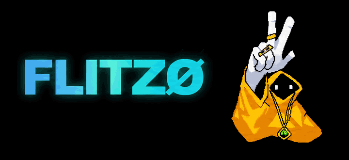
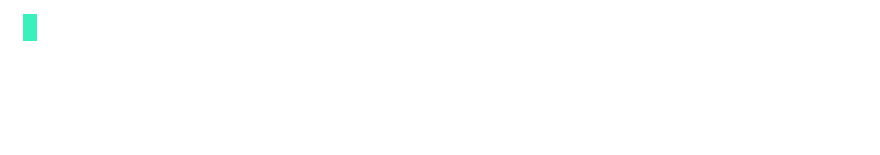
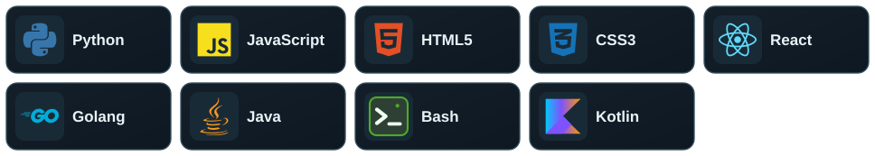
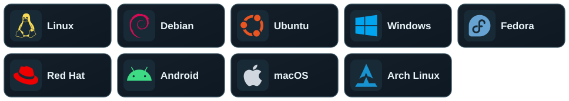
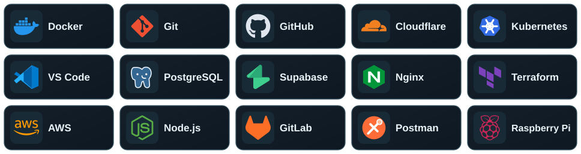
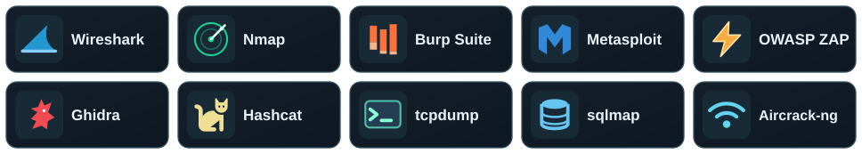
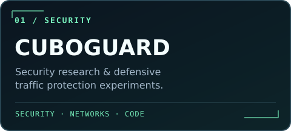
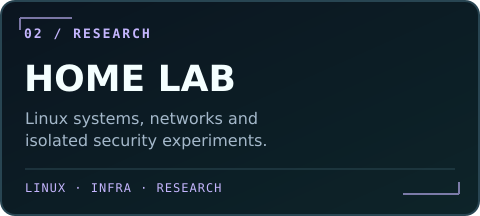
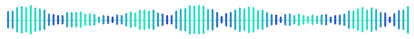

<div align="center">

<p align="center">
  
</p>




<br/>

<p><strong><code>&gt;_ CREATING THINGS THAT SHOULD EXIST.</code></strong></p>
<p><code>Developer</code> &nbsp;•&nbsp; <code>Linux enthusiast</code> &nbsp;•&nbsp; <code>Cybersecurity explorer</code></p>

</div>


## `01` &nbsp; / &nbsp; WHO AM I?

<table>
<tr>
<td width="67%" valign="middle">

<h3>Hey, I'm <strong>Flitzø</strong>. <code>&gt;_</code></h3>
<p>I write code, explore systems and like knowing <strong>how things work beneath the surface</strong>.</p>
<p>My playground includes <strong>web development</strong>, <strong>Linux</strong>, <strong>networks</strong>, and <strong>cybersecurity</strong>. I'm always building something, learning something, or breaking something in a controlled environment to understand it better.</p>
<p><em>"I create things. Sometimes I break them."</em></p>
<p><strong>Current focus:</strong> Software engineering · Infrastructure · Defensive security</p>

</td>
<td width="33%" align="center" valign="middle">


</td>
</tr>
</table>


## `02` &nbsp; / &nbsp; MY ARSENAL

<div align="center">

<p><strong><code>LANGUAGES &amp; FRAMEWORKS</code></strong></p>


<br/>

<p><strong><code>OPERATING SYSTEMS</code></strong></p>


<br/>

<p><strong><code>DEVOPS &amp; INFRASTRUCTURE</code></strong></p>


<br/>

<p><strong><code>CYBERSECURITY / LAB TOOLS</code></strong></p>


<sub>My toolbox for building, breaking down and understanding systems — security research in authorized environments.</sub>

</div>


## `03` &nbsp; / &nbsp; PROJECTS YOU CAN KNOW ABOUT

<div align="center">

<p><strong><code>PUBLIC ACCESS LEVEL: LIMITED</code></strong></p>

<table>
<tr>
<td align="center"></td>
<td align="center"></td>
</tr>
</table>

<p><em>"These are the ones you're allowed to know about. The rest stays off the record."</em></p>

<sub>Selected experiments from the lab. More will be revealed when the time is right.</sub>

</div>


## `04` &nbsp; / &nbsp; OPERATOR'S NOTES

```bash
flitzo@terminal:~$ cat current_focus.txt

[+] Building useful things
[+] Studying Linux and network fundamentals
[+] Exploring cybersecurity in authorized labs
[+] Reverse engineering & understanding the unknown
[+] Reverse engineering & understanding the unknown
[+] Improving my code, one commit at a time

flitzo@terminal:~$ echo "Stay curious."
Stay curious.
```

<details>
<summary><b>▶ ACCESS THE HIDDEN FILE</b></summary>
<br/>

```text
/var/log/flitzo/manifesto.txt

There is no magic.
Only systems we haven't understood yet.

Learn the rules.
Question assumptions.
Build better things.
```

</details>


<div align="center">



<p><strong><code>CONNECTION ESTABLISHED // CURIOSITY NEVER OFFLINE</code></strong></p>

<sub>Made with code, caffeine & a little chaos. © Flitzø</sub>

</div>
